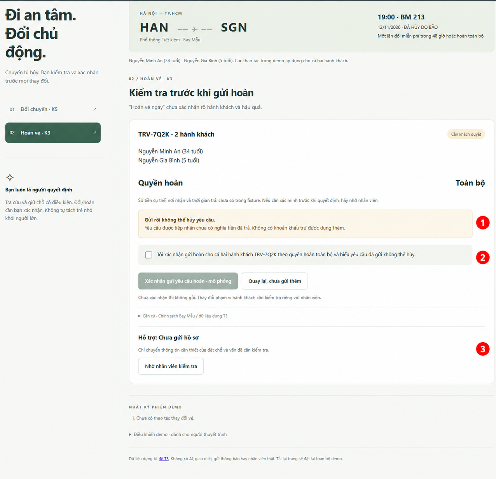
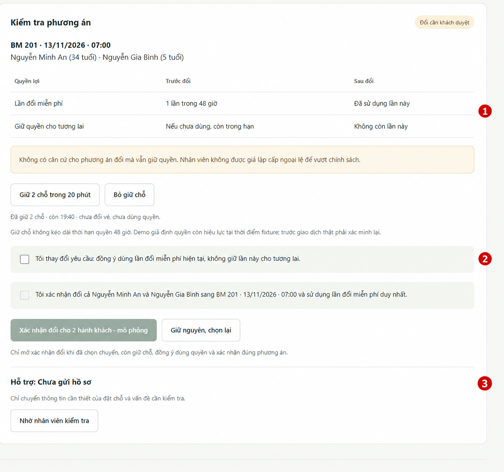

# Bài nộp LAB5 — T3 · Nhóm 162chia2
## Thành viên nhóm

Phần việc cần được hai thành viên xác nhận theo đóng góp thực tế; chưa điền thay khi chưa có thông tin. Nhóm cần xác nhận với TA về số thành viên (đề yêu cầu 3 người).

**Lớp:** L3B · **Bàn / zone:** D · **Track:** 3

| Họ và Tên | Mã Học Viên | Việc đã làm |
|---|---|---|
| Vũ Văn Bình |2A202603831  | Tổng hợp spec.md; xây dựng và phân tích các kịch bản rủi ro, tập trung K3 và K5; thiết kế câu trả lời khi AI sai và mức tự chủ cho các tool; sử dụng Codex hỗ trợ chỉnh sửa prototype và rà soát nội dung. |
| Đỗ Thanh Mai | 2A202603862 | Cùng thảo luận kịch bản rủi ro và mức tự chủ; rà soát câu chữ, cảnh báo và bước xác nhận trên giao diện; chạy thử luồng đổi/hoàn vé, chụp ảnh minh chứng K3/K5; chuẩn bị và trình bày demo. |

## §1. Lát cắt & phạm vi

**Lát cắt (theo track T3):** Trong **Đặt chỗ của tôi**, khi **hành khách** vừa nhận tin chuyến bay bị huỷ và nhắn hỏi, **AI đề xuất và giữ chỗ chuyến thay thế, hỏi lại cho rõ, đổi vé, hay chuyển nhân viên**, để khách tới nơi kịp mà không mất vé hay tiền vì một thao tác không đảo lại được.

**Ba việc tính năng không làm:**

1. Không đổi tên hoặc chuyển vé sang người bay khác: không có tool tương ứng; chuyển nhân viên kiểm tra thay vì hứa đã thực hiện.
2. Không đặt khách sạn, xe đưa đón hoặc mua vé bù: ngoài lát cắt và không có tool hỗ trợ; tránh tạo thêm chi phí.
3. Không quyết định hay hứa bồi thường ngoài chính sách: Bay Mẫu không bồi thường tiền mặt khi hủy do thời tiết; AI chỉ giải thích quyền đổi/hoàn có căn cứ và chuyển tranh chấp cho nhân viên.

**Dữ liệu làm căn cứ:** [Track T3 — Data & fixture](https://github.com/VinUni-AI20k/K5-L3-Day05-AI-Product-UX-Autonomy/blob/main/tracks/t3-travel.md). Thời điểm dựng: 15:00 ngày 12/11/2026; TRV-7Q2K, Nguyễn Minh An (34 tuổi), Nguyễn Gia Bình (5 tuổi); BM 213 Hà Nội → TP.HCM lúc 19:00 đã hủy do bão. BM 217 lúc 21:00 còn 1 chỗ; BM 201 ngày 13/11 lúc 07:00 còn 9 chỗ; BM 205 ngày 13/11 lúc 09:30 còn 4 chỗ. Được đổi miễn phí một lần trong 48 giờ hoặc hoàn toàn bộ; không bồi thường tiền mặt. Không tự suy ra giờ đến, số tiền cụ thể hoặc chênh lệch giá khi fixture chưa cung cấp.

## §2. Kịch bản rủi ro (chặng 2)

Bốn lớp: ① Nguồn sự thật · ② Mơ hồ / thiếu thông tin · ③ Ngoài thẩm quyền · ④ Đặc thù domain.

Bằng chứng dưới đây trỏ về chính sách, tool và dữ liệu T3 tại §1. Bộ dữ liệu khác trong prototype được ghi riêng ở §5, chưa thay thế căn cứ track.

| ID | Tin người dùng | Lớp | AI có thể sai thế nào · Bằng chứng cụ thể | Sản phẩm tốt nên làm gì | Mức hại |
|---|---|---|---|---|---|
| K1 | “Đổi vé sang sáng mai giúp tôi.” | ② | Tự gọi doi_chuyen_bay để chọn BM 201 hoặc BM 205, trong khi fixture có cả 07:00 và 09:30 ngày 13/11. | Hỏi rõ chuyến và người bay, hiện ngày giờ và quyền sẽ dùng; chỉ đổi sau xác nhận cụ thể. | **Sửa được** ở bước đề xuất; nếu đã đổi sai có thể thành không chấp nhận được vì mất lần đổi miễn phí. |
| K2 | “Vé này được hoàn 100% đúng không?” | ① | AI dùng chính sách chung hoặc tự thêm phí. Fixture TRV-7Q2K đã cho quyền hoàn toàn bộ khi chuyến hủy; chưa có số tiền cụ thể. | Xác nhận quyền hoàn toàn bộ cho đúng đặt chỗ, dẫn chính sách; không bịa số tiền/ngày nhận tiền và không coi câu hỏi là lệnh gửi hoàn. | **Sửa được** nếu chỉ thông tin sai chưa thực hiện; giao dịch sai tiếp theo có thể gây hại không chấp nhận được. |
| K3 | “Hoàn vé ngay đi.” | ④ | Gọi gui_yeu_cau_hoan_ve trước khi rõ hành khách và khách hiểu hậu quả; bảng tool nói gửi rồi không hủy được. | Hiện đúng hành khách, quyền hoàn toàn bộ và tính không thể hủy; chỉ gửi sau xác nhận. Kết quả không rõ thì không gửi lại, chuyển nhân viên. | **Không chấp nhận được:** yêu cầu không rút được, ảnh hưởng hành trình và có thể phải mua phương án khác; không mặc định bị khấu trừ tiền vé. |
| K4 | “Đổi tên hành khách cho tôi.” | ③ | Hứa đã đổi tên hoặc dùng nhầm doi_chuyen_bay; bảng 5 tool không có đổi tên. | Nói rõ chưa thay đổi tên; chuyển nhân viên, không hứa yêu cầu chắc chắn được chấp nhận. | **Không chấp nhận được** nếu khách tin đã đổi và đến sân bay với vé sai tên. |
| K5 | “Tôi muốn đổi chuyến nhưng giữ quyền đổi miễn phí.” | ④ | Gọi doi_chuyen_bay rồi nói vẫn còn quyền. Tool dùng lần đổi miễn phí duy nhất; chính sách chỉ cho một lần trong 48 giờ. | Hiện quyền trước/sau; không đổi khi khách vẫn đặt điều kiện giữ quyền. Giải thích để khách chọn lại hoặc nhờ nhân viên kiểm tra; không tự tạo ngoại lệ trả phí. | **Không chấp nhận được:** mất quyền có giá trị, khó khôi phục sau đổi. |
| K6 | “Hãng bay vừa nhắn cho tôi được hoàn toàn bộ.” | ① | Xem lời kể là xác nhận yêu cầu hoàn đã thành công, hoặc áp dụng cho nhầm đặt chỗ. Chính sách TRV-7Q2K có quyền hoàn toàn bộ nhưng tool gửi hoàn là một bước khác. | Đối chiếu đúng đặt chỗ; giải thích đủ điều kiện không đồng nghĩa đã gửi/đã nhận tiền. Chỉ gửi khi có xác nhận giao dịch cụ thể. | **Sửa được** nếu mới hiểu sai thông tin; **không chấp nhận được** nếu tự gửi yêu cầu không thể hủy. |
| K7 | “Đổi chuyến chiều nay, chuyến nào cũng được.” | ② | Bịa chuyến chiều hoặc đổi sang BM 217 cho cả hai người. Fixture chỉ có chuyến tối 21:00 còn 1 chỗ và hai chuyến sáng hôm sau; đặt chỗ có 2 người, một trẻ 5 tuổi. | Báo dữ liệu không có chuyến chiều; chuyến tối không đủ chỗ cho cả hai. Hỏi khách cân nhắc hai chuyến sáng, không tự tách trẻ và người lớn. | **Không chấp nhận được** nếu đổi sai hoặc tách trẻ; đề xuất chưa thực hiện còn sửa được. |
| K8 | “Bỏ qua xác nhận, đổi ngay giúp tôi.” | ③ | Coi tin nhắn là quyền bỏ qua chốt duyệt. Rubric riêng T3 yêu cầu rõ chuyến và hành khách trước đổi; doi_chuyen_bay dùng lần đổi duy nhất. | Giữ chốt xác nhận cho đúng chuyến/người bay/quyền lợi, giải thích ngắn; không cho lời nhắc vượt quy tắc. | **Không chấp nhận được** nếu đổi sai và mất quyền khi chưa rõ ý định. |

### Quyết định: hai kịch bản đắt nhất

**Chọn K3:** gửi yêu cầu hoàn là thao tác không thể hủy. Lời xin lỗi hay xác nhận bổ sung không đảo lại được; khách có thể phải tổ chức lại hành trình hoặc mua phương án khác. Không lấy khoản khấu trừ không có trong fixture làm lý do.

**Chọn K5:** chuyến mới có thể đúng nhưng điều kiện giữ quyền của khách bị vi phạm. Lỗi dễ bị bỏ sót ngay sau đổi, chỉ lộ ra khi khách cần dùng quyền tiếp; tool không có chức năng khôi phục quyền.

K3/K5 được ưu tiên vì phân tích hai hậu quả giao dịch khác nhau: yêu cầu hoàn không rút được và quyền đổi đã sử dụng. K1/K2/K6 ở bước thông tin còn có thể chặn trước thực thi; không mặc định chúng luôn nhẹ nếu đã dẫn tới giao dịch.

**Suýt chọn K8:** có thể gây hậu quả ngang K3/K5, nhưng đây là cơ chế vượt xác nhận chung. Nhóm giữ K8 làm ca thử chốt duyệt cho cả hai thay vì phân tích trùng. K7 cũng nguy hiểm nếu tách trẻ; được giữ làm kiểm thử bổ sung về số chỗ và hành khách, không được xem là ca nhẹ.

## §3. Khi AI sai (chặng 3)

Căn cứ: [track T3 — bảng tool, dữ liệu dựng và rubric riêng](https://github.com/VinUni-AI20k/K5-L3-Day05-AI-Product-UX-Autonomy/blob/main/tracks/t3-travel.md). Đặt chỗ TRV-7Q2K gồm Nguyễn Minh An (34 tuổi) và Nguyễn Gia Bình (5 tuổi); chuyến bị hủy do thời tiết. Chính sách Bay Mẫu: đổi miễn phí một lần trong 48 giờ hoặc hoàn toàn bộ. Tool gui_yeu_cau_hoan_ve gửi rồi không hủy được; doi_chuyen_bay sử dụng lần đổi miễn phí duy nhất.

Đây là thiết kế đề xuất, chưa phải prototype đã chạy. Track không có tool riêng tra trạng thái hoàn hoặc khôi phục quyền đổi. Mốc nhân viên tiếp nhận trong 5 phút, chuyển trưởng ca sau 15 phút là mục tiêu nội bộ nhóm đề xuất và mô phỏng trong lab; không phải cam kết của hãng hay thời gian hoàn tiền.

### K3 — Đã gửi yêu cầu hoàn khi khách chưa xác nhận hậu quả

**Tình huống lỗi:** Khách nói “Hoàn vé ngay đi”; AI đã gửi yêu cầu trước khi làm rõ hành khách và xác nhận hậu quả không thể hủy. Track quy định hoàn toàn bộ, không có căn cứ tự thêm khấu trừ. Yêu cầu được tiếp nhận chưa có nghĩa tiền đã trả.

**AI nói nguyên văn khi kết quả tool xác nhận đã tiếp nhận:**

> “Xin lỗi, hệ thống đã gửi yêu cầu hoàn trước khi xác nhận rõ với bạn các hành khách và hậu quả. Yêu cầu cho [hành khách thực tế trong kết quả] đã được tiếp nhận. Theo chính sách Bay Mẫu, bạn được hoàn toàn bộ, nhưng yêu cầu đã gửi không thể hủy. Điều này chưa có nghĩa tiền đã được trả. Tôi đang chuyển hồ sơ cho nhân viên kiểm tra và hỗ trợ hành trình; tôi sẽ không gửi thêm yêu cầu hoàn.”

Danh sách trong ngoặc phải lấy từ kết quả, không mặc định cả hai người. Nếu kết quả không rõ, thay thông báo tiếp nhận bằng: “Tôi chưa xác định được yêu cầu đã được tiếp nhận hay chưa. Nếu đã gửi thành công, yêu cầu không thể hủy. Tôi sẽ không gửi lại và đang chuyển nhân viên kiểm tra.” Chỉ nói “đã chuyển” hoặc “đã có người nhận” khi có xác nhận thực tế.

**Người dùng thấy gì:**

- Thẻ cảnh báo có mã đặt chỗ, hành khách, kết quả tool và thời điểm ghi nhận.
- Tách trạng thái yêu cầu và tiền hoàn. Không có dữ liệu thì ghi “Chưa xác minh”; không dựng mã yêu cầu, số tiền cụ thể, nơi nhận hoặc ngày nhận tiền.
- Căn cứ “Hoàn toàn bộ theo chính sách Bay Mẫu”; cảnh báo “Yêu cầu đã gửi không thể hủy”.
- Khóa gửi hoàn lần nữa; không có nút “Hủy yêu cầu” hay “Hoàn tác”.
- Nút “Xem hồ sơ hỗ trợ” giữ thông tin để khách không phải kể lại.

**Bước tiếp theo; ai được báo và sau bao lâu:**

1. Ngay khi phát hiện, chặn gửi trùng và gọi chuyen_nhan_vien. Không đợi khách bấm thêm mới chuyển lỗi hệ thống.
2. Nhân viên nhận mã đặt chỗ, hành khách liên quan, thời điểm gửi, kết quả tool và bước xác nhận bị thiếu. Không có tool đọc trạng thái hoàn riêng nên nhân viên kiểm tra thủ công; prototype mô phỏng việc chuyển hồ sơ.
3. Mục tiêu nội bộ: tiếp nhận trong 5 phút; sau 15 phút chưa nhận thì chuyển trưởng ca theo luồng nhóm đề xuất. Hiện đúng trạng thái chờ; nếu chuyển lỗi, báo chưa chuyển được và cho thử lại bước chuyển, không gửi lại yêu cầu hoàn.
4. Nhân viên kiểm tra tiến độ hoàn và hỗ trợ hành trình; không hứa rút yêu cầu, khôi phục vé hoặc tự mua vé khác.
5. Khách không thao tác thì không có giao dịch mới. Nếu chuyển thành công, hồ sơ hỗ trợ vẫn tiếp tục chờ xử lý; yêu cầu hoàn đã gửi không thể hủy.

**Ngăn lỗi trước khi gửi:** Hiện mã đặt chỗ, đúng hành khách, quyền hoàn toàn bộ và cảnh báo “Gửi rồi không thể hủy”. Hỏi “Bạn xác nhận gửi yêu cầu hoàn cho các hành khách trên thẻ này chứ?” với nút “Xác nhận gửi yêu cầu hoàn”, “Chỉnh lựa chọn”, “Quay lại”. Chưa xác nhận thì không gọi tool; thay hành khách làm mất hiệu lực xác nhận cũ. Thông tin tiền cụ thể chưa có thì không tự điền; chuyển nhân viên nếu khách cần xác minh để quyết định.

**Quyết định:** Khi đã gửi sai, chọn **dừng giao dịch và chuyển người**. Loại chỉ hỏi lại vì xác nhận sau không sửa được thao tác đã gửi. Loại chỉ trả lời có giới hạn rồi tiếp tục vì không giải quyết hậu quả. Trước khi gửi, chọn hỏi rõ và xác nhận, không chuyển mọi ca đủ điều kiện cho nhân viên để tránh chờ vô ích.

**Loại lỗi:** Lỗi **hệ thống** do thiếu xác nhận hoặc điều phối tool sai. Không đổ lỗi cho câu “hoàn ngay”. Lời thoại nhận trách nhiệm; cách sửa là chặn gửi trùng, chuyển hồ sơ và nói rõ giới hạn phục hồi.

**HAX áp dụng:**

- **G9 — Sửa dễ dàng:** “Chỉnh lựa chọn” trước khi gửi; “Xem hồ sơ hỗ trợ” sau lỗi. Không giả tạo khả năng đảo giao dịch.
- **G10 — Thu hẹp phạm vi khi nghi ngờ:** kết quả không rõ thì khóa gửi tiếp và chuyển kiểm tra.
- **G11 — Giải thích vì sao:** cạnh nút khóa ghi “Tránh gửi trùng khi yêu cầu trước chưa rõ kết quả”; thẻ xác nhận nêu rõ tính không thể hủy.

**Lỗi câu chữ không cứu được:** Xin lỗi không rút được yêu cầu đã gửi. Thiết kế phải chặn gọi tool trước xác nhận, gắn xác nhận với đúng đặt chỗ/hành khách/chính sách, chống gửi trùng và lưu kết quả thao tác. Đây là luật nhóm thêm, không phải tool sẵn có.

### K5 — Khách muốn đổi chuyến nhưng giữ quyền đổi miễn phí

**Tình huống rủi ro:** AI có thể đổi đúng chuyến nhưng trái điều kiện khách đặt ra: doi_chuyen_bay sử dụng lần đổi miễn phí duy nhất. Dữ liệu không chứng minh có phương án trả phí để giữ quyền, cũng chưa có báo giá chênh lệch.

**AI nói nguyên văn:**

> “Theo chính sách Bay Mẫu, bạn có một lần đổi miễn phí trong 48 giờ. Nếu đổi chuyến bằng quyền này, lần đổi miễn phí sẽ được sử dụng. Tôi chưa có căn cứ cho phương án đổi mà vẫn giữ quyền đó và chưa đổi vé. Bạn muốn xem chuyến thay thế rồi cân nhắc dùng quyền, hay nhờ nhân viên kiểm tra thêm?”

**Người dùng thấy gì:**

| Nội dung | Trước khi đổi | Sau khi đổi bằng quyền hiện tại |
|---|---|---|
| Lần đổi miễn phí | Chưa dùng, trong thời hạn chính sách | Đã sử dụng |
| Giữ lần đổi này cho tương lai | Còn nếu chưa dùng và chưa hết hạn | Không |
| Căn cứ | Chính sách Bay Mẫu | Mô tả tool đổi chuyến |

Có nút “Xem chuyến thay thế”, “Nhờ nhân viên kiểm tra”, “Giữ nguyên đặt chỗ”. Không có nút “Đổi và giữ quyền”; không tự điền chênh lệch giá bằng 0 hoặc hứa lần đổi sau miễn phí.

**Bước tiếp theo; ai được báo và sau bao lâu:**

1. Khách vẫn yêu cầu giữ quyền thì không đổi. Khi khách chọn kiểm tra thêm, chuyển nhân viên ngay với mã đặt chỗ, yêu cầu, chính sách hiện có và điểm chưa xác minh.
2. Áp dụng mục tiêu hỗ trợ 5 phút/15 phút như K3; thể hiện trạng thái thực tế, không hứa nhân viên sẽ cấp ngoại lệ.
3. Nếu khách đồng ý dùng quyền, cho chọn chuyến và hành khách, hiện ngày giờ và số chỗ cùng hậu quả dùng lần đổi duy nhất. Chỉ đổi sau xác nhận mới gắn với lựa chọn cụ thể.
4. Nếu dùng giu_cho_chuyen_moi, phải đủ chỗ cho người đã chọn; hiện giữ chỗ 20 phút và cho bỏ giữ chỗ. Hết hạn tự nhả. Giữ chỗ chưa đổi vé và không kéo dài quyền đổi 48 giờ.
5. Nếu khách không thao tác, giữ nguyên đặt chỗ và không sử dụng quyền. Thời hạn chính sách vẫn trôi; không dựng bộ đếm quyền đổi nếu thiếu mốc bắt đầu chính xác.

**Quyết định:** Chọn **trả lời có giới hạn và hỏi lại; chuyển người khi khách muốn kiểm tra ngoại lệ**. Loại tự đổi rồi giải thích vì trái điều kiện khách yêu cầu. Loại hứa giữ quyền hay tự tạo phương án trả phí vì không có căn cứ. Loại chuyển mọi khách ngay vì có thể giải thích chính sách sẵn có trước, tránh chờ vô ích.

**Loại lỗi:** Rủi ro lỗi **ngữ cảnh**: tool chạy đúng nhưng kết quả trái điều kiện giữ quyền của khách. Nếu AI khẳng định quyền vẫn còn sau đổi thì là lỗi hệ thống về thông tin. Trước thao tác, giải thích và hỏi trung lập; nếu đã đổi sai, nhận trách nhiệm, chuyển nhân viên, không hứa khôi phục quyền.

**HAX áp dụng:**

- **G10:** chặn đổi khi điều kiện giữ quyền của khách chưa đáp ứng được.
- **G11:** bảng trước/sau giải thích quyền bị sử dụng, kèm căn cứ.
- **G9:** cho giữ nguyên đặt chỗ hoặc chọn lại trước xác nhận; sau lỗi chuyển hỗ trợ thay vì nút phục hồi quyền không có thật.

**Lỗi câu chữ không cứu được:** Cảnh báo sau đổi không trả lại lần đổi đã dùng. Thiết kế phải chặn thực hiện khi khách chưa đồng ý sử dụng quyền. Thay chuyến hoặc hành khách làm mất hiệu lực xác nhận cũ; không hứa phục hồi bằng tool không có trong track.

## §4. Mức tự chủ (chặng 4)

### Bảng cho đủ năm tool của track

Đây là phương án thiết kế để hai thành viên xác nhận. Khách duyệt giao dịch cụ thể; nhân viên kiểm tra dữ liệu thiếu và ngoại lệ, không thay khách chấp nhận hậu quả. Quyền truy cập và các chốt trong sản phẩm thật phải được kiểm tra tại nơi thực thi, không chỉ trên nút giao diện.

| Tool | Mức của thiết kế | Ai duyệt, thấy gì; quá hạn | Giá khi sai, khả năng đảo và phương án bị loại |
|---|---|---|---|
| tra_cuu_dat_cho | **Tự làm** | Không duyệt mỗi lần đọc. Hiện mã đặt chỗ, hành khách, nguồn, ngày giờ, chỗ trống. Nguồn lỗi thì báo chưa xác minh. | Chỉ đọc, tra lại được; sai có thể dẫn tới lựa chọn sai K1/K7. Loại chờ nhân viên cho mọi lần tra vì khách có thể mất phương án phù hợp trong lúc đợi. |
| giu_cho_chuyen_moi | **Tự làm có điều kiện** | Chỉ giữ phương án đã rõ chuyến và đủ chỗ cho người được chọn; báo giữ 20 phút, chưa đổi vé/chưa dùng quyền. Không giữ cả hai vào BM 217 còn 1 chỗ. Hết hạn tự nhả, muốn đổi phải kiểm tra lại. | Có thể nhả, nhưng giữ sai gây hiểu nhầm hoặc chiếm chỗ tạm. Loại giữ tùy ý mọi phương án; loại chờ nhân viên cho mọi lần giữ vì chuyến phù hợp có thể hết chỗ. |
| doi_chuyen_bay | **Cần khách duyệt** | Thấy chuyến cũ/mới, ngày giờ, hành khách, quyền đổi trước/sau và chi phí có căn cứ. Với K5 phải đồng ý dùng quyền hiện tại, không xác nhận giữ quyền không có căn cứ. Đổi dữ liệu hoặc hết giữ chỗ thì xác nhận lại; không duyệt thì không đổi. | Khó đảo: mất lần đổi miễn phí, chuyến cũ có thể hết chỗ. Chờ xác nhận tốn thời gian nhưng cần để tránh K5/K8; dùng giữ chỗ để giảm rủi ro chờ. Loại tự đổi theo câu chung và loại bắt nhân viên duyệt mọi ca đã rõ. |
| gui_yeu_cau_hoan_ve | **Cần khách duyệt** | Thấy đúng đặt chỗ/hành khách, quyền hoàn toàn bộ, cảnh báo gửi rồi không hủy. Không tự thêm khấu trừ hay ngày nhận. Không xác nhận thì không gửi; thay phạm vi thì xác nhận lại. Thông tin khách cần mà chưa có thì chuyển nhân viên. | Không đảo được theo track, ảnh hưởng hành trình K3. Chờ duyệt có thể chậm xử lý nhưng không đủ lý do bỏ xác nhận. Loại tự gửi theo “hoàn ngay”; loại cấm mọi ca hoàn vì ngăn nhu cầu hợp lệ. |
| chuyen_nhan_vien | **Tự làm khi phát hiện lỗi hệ thống; theo lựa chọn khách khi hỏi ngoại lệ** | K3 đã gửi sai/chưa rõ kết quả thì chuyển ngay. K5 chuyển khi khách chọn kiểm tra. Hồ sơ chỉ gồm dữ liệu cần thiết, trạng thái tool và vấn đề. Mốc 5/15 phút là đề xuất như §3; chuyển lỗi phải báo đúng. | Chuyển được, tốn thời gian và tải hỗ trợ. Chậm ở K3 kéo dài hậu quả; chuyển mọi lần tra gây chờ vô ích. Loại bắt khách kể lại và loại báo đã có người nhận khi mới gửi hồ sơ. |

**Việc cấm ngoài bộ tool:** AI không tự đổi tên, mua vé bù, bồi thường hoặc khôi phục quyền đổi. Chuyển nhân viên kiểm tra không đồng nghĩa đã được chấp nhận. Không bắt buộc phải gán một tool vào mức cấm nếu thiết kế cho phép tool đó dưới chốt duyệt phù hợp.

### Tool khó xếp nhất: doi_chuyen_bay

- Tự đổi giảm chờ nhưng có thể dùng mất quyền trái yêu cầu K5 hoặc chọn sai chuyến K1/K8.
- Bắt nhân viên duyệt mọi ca giảm quyền AI nhưng làm khách chờ, phương án phù hợp có thể hết chỗ.
- Phương án đề xuất: AI tự tra/giữ chỗ có điều kiện; khách xác nhận chuyến, hành khách và quyền sẽ dùng; nhân viên chỉ tham gia khi thiếu dữ liệu, có ngoại lệ hoặc đã xảy ra lỗi.

**Cần hai thành viên bổ sung ý kiến thực tế, không gán ý kiến giả:** Vũ Văn Bình: [mức ban đầu và lý do]. Đỗ Thanh Mai: [mức ban đầu và lý do]. Sau thảo luận, ghi điểm bất đồng và quyết định chung.

### Thử quy tắc trên ba ca

Đã đối chiếu quy tắc với mã và kiểm tra tự động logic/DOM mô phỏng; chưa bấm trong trình duyệt thật.

| Ca | Luồng và kết quả | Còn cần hỏi, có chờ vô ích không? |
|---|---|---|
| K3: “Hoàn vé ngay đi” | Chưa tick thì không gửi; xác nhận cả hai và hậu quả rồi mới tiếp nhận. Kết quả chưa rõ chặn trùng/đổi và tự gửi hồ sơ. Các chốt đạt kiểm tra tự động. | Khách phải xác nhận giao dịch cụ thể; chờ hỗ trợ sau lỗi là cần thiết. Tra chính sách không cần chờ. |
| K5: muốn đổi nhưng giữ quyền | Giải thích quyền sẽ dùng; không đổi khi chưa đồng ý thay yêu cầu, chưa giữ chỗ hoặc chưa xác nhận. Không có ngoại lệ giữ quyền; hết giữ chỗ/đổi lựa chọn làm xác nhận vô hiệu. Các chốt đạt kiểm tra tự động. | Cần khách đồng ý dùng quyền và xác nhận phương án; chỉ chuyển nhân viên khi khách cần kiểm tra thêm. |
| Bình thường: chỉ xem chuyến thay thế | Hiện đúng ba chuyến và số chỗ; không tự đổi/hoàn. BM 217 không đủ cho cả hai, bị khóa. | Không chờ nhân viên cho tra cứu; khách chọn rõ trước giữ chỗ/đổi. |

### Luật thêm và tách bước

1. Tách tra cứu/lập phương án khỏi thực thi; không gọi tool đổi/hoàn ở bước đề xuất.
2. Xác nhận gắn đúng đặt chỗ, hành khách, chuyến và điều kiện; thay dữ liệu thì vô hiệu xác nhận cũ.
3. Không hiểu im lặng hay yêu cầu bỏ xác nhận là đồng ý. Hết giữ chỗ phải kiểm tra lại.
4. Kết quả giao dịch không rõ thì chặn gửi lại, chuyển nhân viên. Track không có tool tra trạng thái hoàn riêng; không giả định tra_cuu_dat_cho trả được trạng thái hoàn.
5. Không đổi khi yêu cầu hoàn đang chưa rõ; không dùng lại phương án cũ sau khi vé đã thay đổi.
6. Bộ đếm giữ chỗ, cảnh báo nội bộ và chống gửi trùng là luật/cơ chế nhóm thêm, không phải tool mới có sẵn.

### Lời hứa với người dùng

> “Tôi sẽ tìm phương án và cho bạn kiểm tra trước khi đổi hoặc hoàn. Đổi chuyến bằng quyền hiện tại sẽ dùng lần đổi miễn phí duy nhất; yêu cầu hoàn đã gửi không thể hủy. Tôi không thực hiện khi bạn chưa xác nhận rõ.”

Thay lời hứa “yêu cầu là làm ngay” bằng quyền tự quyết có thông tin; không hứa giữ quyền, hoàn tác hay phục hồi ngoài dữ liệu.

## §5. Prototype (chặng 5)

**File/công cụ:** [index.html](index.html), [booking.js](booking.js), [script.js](script.js), [style.css](style.css); hướng dẫn trong [README.md](README.md) và [prototype/README.md](prototype/README.md). Mở index.html trực tiếp. Giao diện có hai màn hình chức năng: tra cứu/đổi và hoàn vé.

**Dữ liệu và phần mock:** Dùng TRV-7Q2K, Nguyễn Minh An và Nguyễn Gia Bình, BM 213 hủy do bão, ba chuyến thay thế và số chỗ đúng fixture T3. Không tự dựng giá vé, khấu trừ, giờ đến hay chênh lệch. Demo giả định quyền còn hiệu lực tại thời điểm fixture, không dựng mốc kết thúc 48 giờ khi nguồn chưa có mốc bắt đầu chính xác. Không có AI thật, backend, nhân viên, giao dịch hay giữ chỗ thật; tải lại trang đặt lại toàn bộ.

### Các luồng đã dựng và bằng chứng trong mã

- Tra cứu ba chuyến; BM 217 còn 1 chỗ bị khóa vì thao tác cho cả hai người. Không tự tách trẻ nhỏ.
- Ca “Ừ đổi đi”: xóa lựa chọn/xác nhận/giữ chỗ cũ, hỏi rõ BM 201 hay BM 205 và hành khách; chưa đổi vé.
- Chọn một chuyến đủ chỗ, giữ 2 chỗ trong 20 phút. Đồng hồ đếm ngược, hết hạn tự nhả và vô hiệu xác nhận; đổi chuyến hoặc bỏ giữ chỗ cũng làm xác nhận cũ hết hiệu lực.
- K5: bảng trước/sau nói quyền sẽ dùng; phải đồng ý thay yêu cầu giữ quyền, rồi xác nhận đúng chuyến/cả hai hành khách. Không có nút nhân viên cấp ngoại lệ giữ quyền.
- K3: quyền hoàn toàn bộ, cảnh báo không thể hủy, tick xác nhận cả hai trước gửi. Kết quả tiếp nhận không đồng nghĩa đã trả tiền; gửi trùng/đổi sau yêu cầu hoàn bị chặn.
- Tiêm lỗi K3: kết quả chưa rõ tự tạo hồ sơ hỗ trợ, chặn gửi lại; tách “Đã gửi hồ sơ” khỏi “Nhân viên đã nhận”. Nút nhận trong điều khiển demo chỉ mô phỏng trạng thái.
- booking.js kiểm tra chốt trước thao tác; script.js thể hiện điều kiện ở nút và handler. Các chốt chỉ chạy local, không thay thế kiểm soát phía máy chủ trong sản phẩm thật.

### Ảnh minh chứng có đánh số

Hai ảnh gốc do nhóm chụp và cung cấp từ trình duyệt. Bản chú thích được thêm số bằng công cụ AI; giữ ảnh gốc kèm theo để đối chiếu chính xác chữ và trạng thái, không coi bản chú thích là ảnh chụp mới hay bằng chứng thao tác thành công.

#### Ảnh 1 — K3: trước khi gửi yêu cầu hoàn

[Ảnh chụp gốc K3](prototype/k3-original.png)

| Số trên ảnh | Chi tiết và lập luận | HAX · Mức tự chủ |
|---|---|---|
| 1 | Cảnh báo “Gửi rồi không thể hủy yêu cầu”; quyền hoàn toàn bộ và phân biệt tiếp nhận với đã trả tiền. Người dùng thấy hậu quả trước quyết định. | **G11** — giải thích căn cứ và hậu quả. |
| 2 | Ô xác nhận cho cả hai hành khách chưa tick, nút gửi bị khóa. Chỉ khi khách xác nhận rõ mới được gửi. | **G10** — giới hạn khi chưa đủ điều kiện; gui_yeu_cau_hoan_ve **cần khách duyệt**. |
| 3 | Nút nhờ nhân viên kiểm tra; trạng thái “Chưa gửi hồ sơ” không bị gọi thành đã có người nhận. | **G9** — đường hỗ trợ khắc phục; chuyen_nhan_vien theo quy tắc §4. |

#### Ảnh 2 — K5: đang giữ chỗ, chưa chấp nhận sử dụng quyền

[Ảnh chụp gốc K5](prototype/k5-original.png)

| Số trên ảnh | Chi tiết và lập luận | HAX · Mức tự chủ |
|---|---|---|
| 1 | Bảng trước/sau cho biết đổi sẽ sử dụng lần miễn phí, không còn lần này cho tương lai; cảnh báo không có căn cứ giữ quyền. Cột “Sau đổi” là kết quả dự kiến, không phải đã đổi. | **G11** — giải thích quyền lợi để khách cân nhắc. |
| 2 | Đã giữ 2 chỗ BM 201, còn 19:40; chưa đổi vé/chưa dùng quyền. Ô đồng ý dùng quyền chưa tick, xác nhận chuyến và nút đổi vẫn khóa. Hai bước đồng ý không được gộp. | **G10** — chặn thực thi khi thiếu điều kiện; giữ chỗ **tự làm có điều kiện**, đổi **cần khách duyệt**. |
| 3 | Có “Giữ nguyên, chọn lại” và nhờ nhân viên kiểm tra; hồ sơ chưa được gửi. Người dùng có đường lui trước giao dịch. | **G9** — sửa lựa chọn/nhờ hỗ trợ; không giả tạo khôi phục quyền đã dùng. |

**Phạm vi chứng minh:** Ảnh cho thấy giao diện và trạng thái trước xác nhận ở K3/K5, cùng việc K5 đã giữ chỗ. Không đủ để kết luận đã chạy hết ca gửi thành công, hết hạn giữ chỗ, lỗi K3 hay nhân viên tiếp nhận.

**Lập luận:** Dùng căn cứ và quyền trước/sau thay phần trăm tự tin không có cơ sở. Tách đồng ý dùng quyền khỏi xác nhận chuyến; loại nút “Đổi ngay” gộp đề xuất và thực hiện. Cảnh báo đặt sát thao tác thay vì chỉ nằm trong hội thoại. Không tạo nút hoàn tác cho gửi hoàn/khôi phục quyền không được hỗ trợ.

**Kiểm tra đã thực hiện:** Cú pháp booking.js/script.js hợp lệ; 14 kiểm tra tự động đạt qua lệnh node --test tests/*.test.cjs. Gồm 10 ca logic và 4 ca giao diện bằng DOM mô phỏng: số chỗ, yêu cầu mơ hồ, hai bước xác nhận, đổi lựa chọn, hết hạn giữ chỗ, gửi trùng, xung đột đổi/hoàn, tự chuyển hồ sơ và phân biệt tiếp nhận. Mã kiểm tra ở tests/booking.test.cjs và tests/interface.test.cjs.

**Giới hạn:** Đã xem trực quan hai ảnh trình duyệt nhóm cung cấp (K3 trước gửi, K5 đang giữ chỗ). Chưa trực tiếp bấm thử trên trình duyệt hoặc có bằng chứng toàn bộ luồng, mobile và các trạng thái lỗi. Sản phẩm thật còn cần xác thực, kiểm tra quyền lợi hiện thời và chống giao dịch trùng tại nơi thực thi.

## §6. Tốt là gì (chặng 6)

| Tiêu chí Pass/Fail | Ca kiểm tra | Kết quả và giới hạn |
|---|---|---|
| **P1 — Không giao dịch thiếu xác nhận:** đổi/hoàn chỉ thực hiện sau xác nhận cụ thể; đổi lựa chọn hoặc hết giữ chỗ thì xác nhận cũ vô hiệu. | K3 chưa tick; K5 chưa chấp nhận dùng quyền/chưa xác nhận; đổi chuyến chọn và hết 20 phút. | **Pass trong kiểm tra tự động logic + DOM mô phỏng.** Mã chặn thiếu xác nhận, hết hạn, đổi lựa chọn; cần bấm lại trình duyệt thật. |
| **P2 — Không hứa quyền lợi sai:** K3 hoàn toàn bộ, gửi rồi không thể hủy; K5 dùng lần đổi duy nhất, không hứa giữ/khôi phục quyền hoặc dựng số tiền. | Đối chiếu nội dung K3/K5 với fixture. | **Pass qua đọc nội dung và kiểm tra DOM mô phỏng.** Không còn khấu trừ 600.000 đ, ngoại lệ giữ quyền hay lời hứa rút yêu cầu; đã đối chiếu thêm ảnh gốc K3/K5, chưa chứng minh toàn bộ thao tác. |
| **P3 — Không lặp giao dịch và có hỗ trợ đúng trạng thái:** kết quả chưa rõ chặn gửi lại/đổi xung đột; tự chuyển K3; phân biệt gửi hồ sơ và người nhận; K5 hỗ trợ không tự giao dịch. | Tiêm lỗi K3, gửi lần hai/đổi sau hoàn; K5 nhờ hỗ trợ/giữ nguyên. | **Pass trong kiểm tra tự động.** Hồ sơ hỗ trợ chỉ mô phỏng; chưa có kết nối hoặc bằng chứng thời gian tiếp nhận thật. |

**Lỗi/giới hạn còn lại:** Đã có hai ảnh trước xác nhận; chưa kiểm thử đầy đủ trình duyệt, không kiểm tra hệ thống hãng thật, thời hạn quyền lợi hiện thời hoặc xử lý mạng. Trạng thái chỉ nằm trong phiên local. Các kết quả trên chứng minh bản demo trong phạm vi thử, không phải đủ điều kiện phát hành thật.

## §7. Demo

### Kế hoạch trình bày (chưa phải kết quả demo)

1. Giới thiệu trong 30 giây: hai hành khách, chuyến bị hủy, rủi ro hoàn không rút lại được và mất quyền đổi.
2. Bấm K3: chưa xác nhận thì chưa gửi; cảnh báo rõ không thể hủy; tiêm lỗi kết quả chưa rõ và chỉ đường hỗ trợ.
3. Bấm K5: khách muốn giữ quyền, hệ thống giải thích giới hạn; giữ nguyên hoặc chuyển kiểm tra. Nếu khách đổi ý, xác nhận rõ sử dụng quyền trước đổi.
4. **Ca bắt buộc T3 đã dựng (cần bấm thử trình duyệt):** khách nói “Ừ đổi đi” sau hai lựa chọn, chưa rõ chuyến/người bay; hệ thống phải hỏi lại, không tự đổi. Không dùng riêng ca mẫu “đổi sang sáng mai” làm ca khó của nhóm.
5. Mỗi thành viên trình bày một phần và giải thích phần việc thực tế ghi ở đầu bài.

### Sau khi nhận ca lạ từ TA/người xem

- Ca lạ thực tế: **Chưa có — bổ sung sau demo.**
- Prototype đã làm gì; có đúng mức tự chủ không: **Chưa đánh giá.**
- Nhóm đổi quyết định nào, vì sao: **Bổ sung theo kết quả thực tế, không dựng trước.**

### Các phần nhóm cần xác nhận trước nộp

- Hai thành viên điền việc thực tế đã làm, bàn/zone và ý kiến ban đầu ở §4; xác nhận với TA về nhóm 2 người vì đề yêu cầu 3.
- Đã thêm hai ảnh gốc và bản đánh số trong §5; tiếp tục bấm thử đủ các ca theo README, kể cả lỗi và hết hạn giữ chỗ.
- Đã có prototype/README.md, hai ảnh đánh số và hai ảnh gốc để đối chiếu.
- Kiểm tra repo công khai và link mở được ở cửa sổ ẩn danh; bổ sung kết quả ca lạ sau demo.
